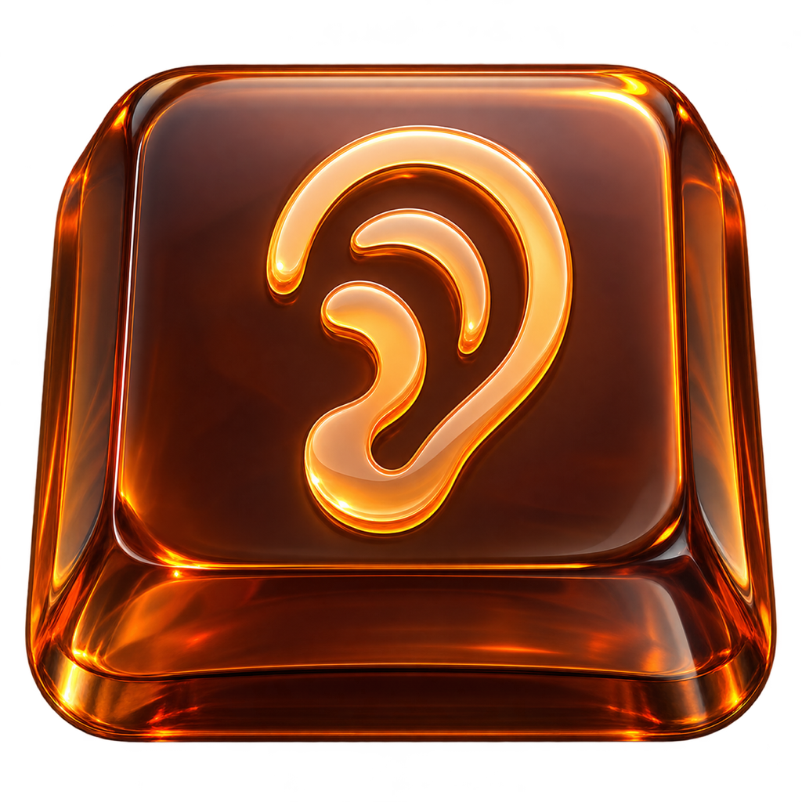

**English** | [Русский](README.ru.md) | [简体中文](README.zh-CN.md)

<p align="center">
  
</p>

# Soundy

Soundy adds keyboard and mouse sounds to macOS and Windows. Mechanical keys, typewriters, electronic tones, and playful effects make everyday computer use more enjoyable.

Pick a sound to match your mood: **40 keyboard profiles and 15 mouse sound options**. All 240 sounds are bundled with the app — no extra downloads needed.

Soundy lives in the menu bar on macOS and in the notification area on Windows. Choose keyboard and mouse sounds separately and adjust the volume. Keyboard profiles are grouped into **Mechanical, Electronic, Fun, and Typewriters** sections. Selecting a profile plays a sample. Your settings are saved between launches. You can turn off mouse sounds while keeping keyboard sounds enabled, or mute everything with **Volume → 0%**.

On macOS, use **Open Soundy…** in the menu bar for the compact 240 × 240 native settings window, with no app icon or heading. Its plain background follows the light or dark appearance of your Mac; macOS controls the window corners and transparency. Preview keyboard and mouse sounds separately, adjust the volume with a slider, and switch languages in one click. The **…** button opens a popover with the app version, [GitHub](https://github.com/not-pro), and [Telegram](https://nbautin.t.me). Closing the window keeps sounds running and releases the window and its controls. Soundy always starts in the menu bar, including at login; the settings window is created only when opened. On Windows every setting lives in the tray menu, which opens where you click.

Enable **Launch at Login** to start Soundy automatically when you sign in. If macOS requests approval, use **Allow in Login Items…** to open System Settings. On Windows this adds a Startup entry that Task Manager also lists.

On macOS, Soundy checks for updates in the background each time it starts. When a newer version is available, an **Update Available: …** item appears in the menu. Click it to download, install, and restart Soundy without running the PKG installer. Update checks do not interrupt you with a dialog.

Every press is one sound, but no two presses sound identical: each one resamples its sample a few percent up or down and shifts the level by up to 1.5 dB, never repeating the previous variant. The right mouse button plays its own click, separate from the primary and middle buttons, and the Bell typewriter profile also answers key-up with its release sample.

Only sounds for the selected keyboard and mouse profiles are loaded into memory on macOS, where previously selected sounds stay cached for 10 seconds after switching, then are released, including while Soundy is idle. Windows decodes one WAV per press and keeps no cache.

**Enabled** in the menu mutes everything while keeping your profiles, volume, and hotkeys; the **Shortcuts** menu records global hotkeys for sound on/off, volume up/down, and toggling the current app's sound (click an action, press the keys, Esc cancels), and they keep working while sounds are off. The **For <App>** menu pins a keyboard profile, a mouse sound, or complete silence to the frontmost application, and **Play Through** restricts sounds to headphones or speakers with the current output shown in the menu. **Stereo Key Position** optionally pans each key to its physical spot. These controls are macOS-only in 2.1.0; the Windows build keeps its existing tray features.

No accounts, subscriptions, or time limits. Sound playback runs locally; on macOS, update checks contact GitHub.

## Getting started

**macOS**

1. Download the `.pkg` from the [latest release](https://github.com/not-pro/Soundy/releases/latest): `arm64` for Apple Silicon or `x86_64` for Intel. Versions before 1.6.0 need this one manual upgrade to enable future in-app updates.
2. Open the installer, click **Continue → Install**, then **Close**. Launch Soundy from Applications. A ZIP archive is also available for manual installation.
3. In Soundy's menu, click **Allow Input Monitoring…** and enable access in macOS settings. Restart Soundy if prompted.
4. Choose **Keyboard Sound** and **Mouse Sound**, adjust the volume, and start typing.

**Windows**

1. Download `Soundy-v*-windows-x64.zip` from the same release and unzip it anywhere you can write to, for example `%LOCALAPPDATA%\Programs`.
2. Run `Soundy.exe`. The sounds live inside the EXE, so no extra folder is needed. A tray icon appears in the notification area; Windows may keep it behind the overflow arrow — drag it out to pin it. The build is not code-signed, so SmartScreen can ask for confirmation: choose **More info → Run anyway**.
3. Right-click the tray icon and choose **Keyboard Sound** and **Mouse Sound**, then start typing.

Requires **macOS 13 or later**, or **Windows 10 or later**.

On macOS, keyboard sounds are unavailable in protected password fields and while Secure Keyboard Entry is enabled: macOS blocks these keystrokes from reaching other apps. Sounds resume when secure input ends. Learn more: [Apple — Secure Event Input](https://developer.apple.com/library/archive/technotes/tn2150/_index.html). On Windows, Soundy uses global low-level hooks, so elevated windows (for example a terminal started as administrator) and the Windows security screen do not send keystrokes to it.

## Language

Soundy supports **English, Russian, and Simplified Chinese**. On first launch, it uses the first supported language in your system language preferences, or English if none match.

Open **Language / Язык / 语言** in the menu bar and choose **English**, **Русский**, or **简体中文**. The change takes effect immediately and is saved for future launches. Sound pack names stay in English.

## Building

You need Rust. macOS builds also need the macOS developer tools, and the native installer is built with the system's `pkgbuild` and `productbuild` tools:

```sh
cargo fetch --locked
sh scripts/package.sh
```

Windows builds produce a portable folder and ZIP with no extra tooling:

```sh
cargo fetch --locked
sh scripts/package-windows.sh
```

The PKG, ZIP, and checksum files will be created in `dist/`. The first build downloads a pinned, checksum-verified Sparkle SDK into `target/`. The Windows ZIP is written to `dist/` as `Soundy-v<version>-windows-x64.zip` with a SHA-256 checksum; unzip it and run `Soundy.exe`. Installer pages are generated by `scripts/installer-pages.swift`, with configuration in `macos/installer/`. To regenerate the icons, run `swift scripts/export-icons.swift`; the Windows icon set comes from `python3 scripts/export-windows-icon.py`.

Tagged GitHub releases also generate signed update feeds with `scripts/appcast.sh`. The private signing key is supplied by the `SPARKLE_PRIVATE_KEY` Actions secret; `SUPublicEDKey` in `macos/Info.plist` contains only its public key. Keep the same signing key for future releases. Native update probes can be run with `python3 scripts/test-updates.py` after building, with the signing key supplied through the environment.
