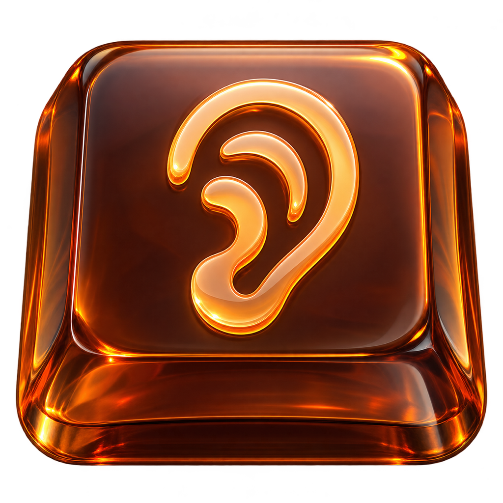

[English](README.md) | **Русский** | [简体中文](README.zh-CN.md)

<p align="center">
  
</p>

# Soundy

Soundy добавляет звуки клавиатуре и мыши на macOS и Windows. Механические клавиши, печатные машинки, электронные сигналы и необычные эффекты делают повседневную работу за компьютером приятнее.

Выберите звучание под настроение: **40 профилей клавиатуры и 15 вариантов звука мыши**. Все 240 звуков уже внутри приложения — ничего дополнительно устанавливать не нужно.

Soundy живёт в строке меню на macOS и в области уведомлений на Windows. Там можно выбрать звуки клавиатуры и мыши по отдельности и настроить громкость. Профили клавиатуры разделены на секции **«Механические», «Электронные», «Эффекты» и «Печатные машинки»**. При выборе профиля звучит пример. Настройки сохраняются между запусками. Звук мыши можно отключить, оставив клавиатуру, или выключить все звуки через **«Громкость → 0%»**.

В macOS нажмите **«Открыть Soundy…»** в строке меню, чтобы открыть компактное нативное окно настроек 240 × 240 без иконки и заголовка приложения. Окно использует нативную прозрачность AppKit и следует светлой или тёмной теме Mac, включая настройку «Уменьшение прозрачности»; форму углов и прозрачность задаёт macOS. Кнопки воспроизведения позволяют отдельно прослушать клавиатуру и мышь; громкость регулируется ползунком, язык — одним нажатием. Кнопка **…** открывает окно с версией приложения, [GitHub](https://github.com/not-pro) и [Telegram](https://nbautin.t.me). Закрытие окна освобождает его и элементы управления; звуки продолжают работать. Soundy всегда запускается только в трее, в том числе при входе в систему, а окно создаётся по запросу. В Windows все настройки находятся в меню значка в области уведомлений.

Включите **«Запускать при входе в систему»**, чтобы Soundy запускался автоматически. Если macOS запросит подтверждение, пункт **«Разрешить в объектах входа…»** откроет системные настройки. В Windows добавляется запись в автозапуск, которую также показывает диспетчер задач.

В macOS Soundy при каждом запуске проверяет обновления в фоне. Если доступна новая версия, в меню появляется пункт **«Доступно обновление: …»**. Нажмите его, чтобы скачать обновление, установить и перезапустить Soundy без запуска PKG. Проверка не показывает всплывающих окон. В Windows новая версия устанавливается распаковкой нового ZIP поверх старой папки.

Каждое нажатие — один звук, но два нажатия не звучат одинаково: высота и длительность сэмпла меняются на несколько процентов, громкость — до ±1,5 дБ, и предыдущий вариант не повторяется. Правая кнопка мыши играет свой клик, отдельный от основной и средней, а профиль печатной машинки Bell отвечает на отпускание клавиши своим release-сэмплом.

В macOS в память загружаются только звуки выбранных профилей клавиатуры и мыши; после переключения предыдущие звуки остаются в кэше 60 секунд, затем освобождаются, даже когда Soundy простаивает. В Windows файл декодируется при каждом нажатии, кэша нет.

Без аккаунтов, подписок и ограничений по времени. Звуки воспроизводятся локально; в macOS проверка обновлений обращается к GitHub.

## Начать пользоваться

**macOS**

1. Скачайте `.pkg` из [последнего релиза](https://github.com/not-pro/Soundy/releases/latest): `arm64` для Apple Silicon или `x86_64` для Intel. Для версий до 1.6.0 потребуется это одно ручное обновление, чтобы следующие обновления устанавливались из приложения.
2. Откройте установщик, нажмите **«Продолжить» → «Установить»**, затем **«Закрыть»**. Запустите Soundy из «Программ». Также доступен ZIP для ручной установки.
3. В меню Soundy нажмите **«Разрешить мониторинг ввода…»** и включите доступ в настройках macOS. Если система попросит, перезапустите Soundy.
4. Выберите **«Звук клавиатуры»** и **«Звук мыши»**, настройте громкость и печатайте.

**Windows**

1. Скачайте `Soundy-v*-windows-x64.zip` из того же релиза и распакуйте в любую папку, доступную для записи, например `%LOCALAPPDATA%\Programs`.
2. Запустите `Soundy.exe` из распакованной папки `Soundy`. В области уведомлений появится значок; Windows может спрятать его под стрелку — перетащите значок на панель. Сборка не подписана, поэтому SmartScreen может попросить подтверждение: выберите **«Подробнее» → «Выполнить в любом случае»**.
3. Нажмите правой кнопкой на значок и выберите **«Звук клавиатуры»** и **«Звук мыши»**, затем начинайте печатать.

Нужна **macOS 13 или новее**, либо **Windows 10 или новее**.

В macOS защищённые парольные поля и включённый Secure Keyboard Entry блокируют звуки клавиатуры: macOS блокирует передачу этих нажатий сторонним приложениям. После выхода из защищённого ввода звуки возобновляются. Подробнее: [Apple — Secure Event Input](https://developer.apple.com/library/archive/technotes/tn2150/_index.html). В Windows Soundy использует глобальные низкоуровневые хуки, поэтому окна с повышенными правами (например, терминал, запущенный от администратора) и экран безопасности Windows не передают ему нажатия.

## Язык

Soundy поддерживает **английский, русский и упрощённый китайский**. При первом запуске выбирается первый поддерживаемый язык из системных настроек языка. Если совпадений нет, используется английский.

Откройте **Language / Язык / 语言** в меню приложения и выберите **English**, **Русский** или **简体中文**. Язык меняется сразу и сохраняется между запусками. Названия звуковых наборов остаются на английском.

## Сборка

Для сборки нужен Rust; для macOS также нужны инструменты разработчика macOS, а нативный установщик создаётся системными `pkgbuild` и `productbuild`:

```sh
cargo fetch --locked
sh scripts/package.sh
```

Сборка для Windows не требует дополнительных инструментов и даёт папку с ZIP:

```sh
cargo fetch --locked
sh scripts/package-windows.sh
```

Готовые PKG, ZIP и контрольные суммы появятся в `dist/`. При первой сборке в `target/` скачивается фиксированная версия Sparkle SDK с проверкой контрольной суммы. Страницы установщика генерирует `scripts/installer-pages.swift`, настройки находятся в `macos/installer/`. Windows ZIP появляется в `dist/` как `Soundy-v<версия>-windows-x64.zip` с контрольной суммой SHA-256; распакуйте его и запустите `Soundy.exe`. Иконки можно пересоздать командой `swift scripts/export-icons.swift`, а набор для Windows — `python3 scripts/export-windows-icon.py`.

При публикации тега GitHub Actions также создаёт подписанные ленты обновлений через `scripts/appcast.sh`. Закрытый ключ хранится в секрете `SPARKLE_PRIVATE_KEY`, а `SUPublicEDKey` в `macos/Info.plist` содержит только открытый ключ. Для следующих релизов сохраняйте тот же ключ подписи.
