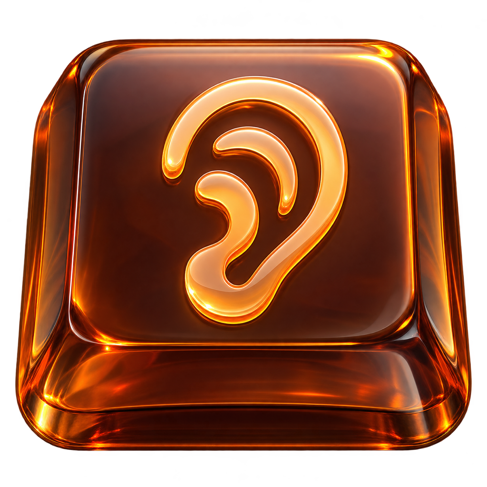

[English](README.md) | **Русский** | [简体中文](README.zh-CN.md)

<p align="center">
  
</p>

# Soundy

Soundy добавляет звуки клавиатуре и мыши на macOS. Механические клавиши, печатные машинки, электронные сигналы и необычные эффекты делают повседневную работу за компьютером приятнее.

Выберите звучание под настроение: **40 профилей клавиатуры и 15 вариантов звука мыши**. Все 240 звуков уже внутри приложения — ничего дополнительно устанавливать не нужно.

Soundy живёт в строке меню. Там можно выбрать звуки клавиатуры и мыши по отдельности и настроить громкость. Профили клавиатуры разделены на секции **«Механические», «Электронные», «Эффекты» и «Печатные машинки»**. При выборе профиля звучит пример. Настройки сохраняются между запусками. Звук мыши можно отключить, оставив клавиатуру, или выключить все звуки через **«Громкость → 0%»**.

Нажмите **«Открыть Soundy…»** в строке меню, чтобы открыть настройки в стиле orange glass. В окне доступны те же настройки и действия, что и в меню. Закрытие окна освобождает его и элементы управления; звуки продолжают работать. Soundy всегда запускается только в трее, в том числе при входе в систему, а окно создаётся по запросу.

Включите **«Запускать при входе в систему»**, чтобы Soundy запускался автоматически. Если macOS запросит подтверждение, пункт **«Разрешить в объектах входа…»** откроет системные настройки.

При каждом запуске Soundy проверяет обновления в фоне. Если доступна новая версия, в меню появляется пункт **«Доступно обновление: …»**. Нажмите его, чтобы скачать обновление, установить и перезапустить Soundy без запуска PKG. Проверка не показывает всплывающих окон.

В память загружаются только звуки выбранных профилей клавиатуры и мыши. После переключения предыдущие звуки остаются в кэше 60 секунд, затем освобождаются, даже когда Soundy простаивает.

Без аккаунтов, подписок и ограничений по времени. Звуки воспроизводятся локально; проверка обновлений обращается к GitHub.

## Начать пользоваться

1. Скачайте `.pkg` из [последнего релиза](https://github.com/not-pro/Soundy/releases/latest): `arm64` для Apple Silicon или `x86_64` для Intel. Для версий до 1.6.0 потребуется это одно ручное обновление, чтобы следующие обновления устанавливались из приложения.
2. Откройте установщик, нажмите **«Продолжить» → «Установить»**, затем **«Закрыть»**. Запустите Soundy из «Программ». Также доступен ZIP для ручной установки.
3. В меню Soundy нажмите **«Разрешить мониторинг ввода…»** и включите доступ в настройках macOS. Если система попросит, перезапустите Soundy.
4. Выберите **«Звук клавиатуры»** и **«Звук мыши»**, настройте громкость и печатайте.

Нужна **macOS 13 или новее**.

В защищённых парольных полях и при включённом Secure Keyboard Entry звуки клавиатуры недоступны: macOS блокирует передачу этих нажатий сторонним приложениям. После выхода из защищённого ввода звуки возобновляются. Подробнее: [Apple — Secure Event Input](https://developer.apple.com/library/archive/technotes/tn2150/_index.html).

## Язык

Soundy поддерживает **английский, русский и упрощённый китайский**. При первом запуске выбирается первый поддерживаемый язык из настроек macOS. Если совпадений нет, используется английский.

Откройте **Language / Язык / 语言** в меню приложения и выберите **English**, **Русский** или **简体中文**. Язык меняется сразу и сохраняется между запусками. Названия звуковых наборов остаются на английском.

## Сборка

Для сборки нужны Rust и инструменты разработчика macOS. Нативный установщик создаётся системными `pkgbuild` и `productbuild`:

```sh
cargo fetch --locked
sh scripts/package.sh
```

Готовые PKG, ZIP и контрольные суммы появятся в `dist/`. При первой сборке в `target/` скачивается фиксированная версия Sparkle SDK с проверкой контрольной суммы. Страницы установщика генерирует `scripts/installer-pages.swift`, настройки находятся в `macos/installer/`. Иконки можно пересоздать командой `swift scripts/export-icons.swift`.

При публикации тега GitHub Actions также создаёт подписанные ленты обновлений через `scripts/appcast.sh`. Закрытый ключ хранится в секрете `SPARKLE_PRIVATE_KEY`, а `SUPublicEDKey` в `macos/Info.plist` содержит только открытый ключ. Для следующих релизов сохраняйте тот же ключ подписи.
