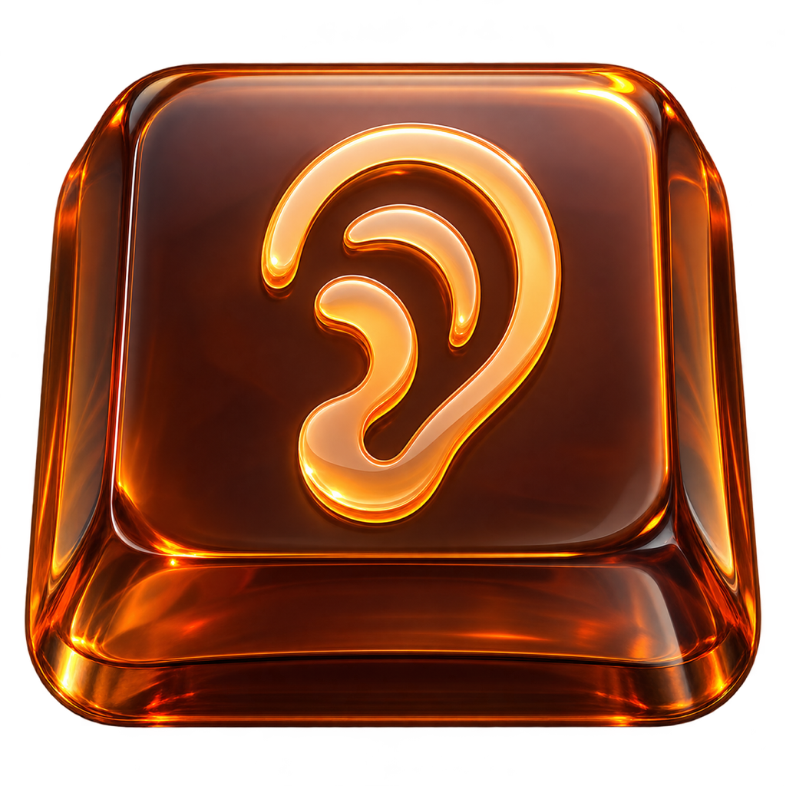

[English](README.md) | [Русский](README.ru.md) | **简体中文**

<p align="center">
  
</p>

# Soundy

Soundy 为 macOS 和 Windows 的键盘和鼠标添加音效。机械键盘、打字机、电子提示音和趣味音效，让日常使用电脑的过程更加愉悦。

随心选择喜欢的声音：**40 种键盘音效和 15 种鼠标音效**。全部 240 个声音文件均已内置，无需额外下载。

Soundy 在 macOS 上常驻菜单栏，在 Windows 上常驻通知区域（系统托盘）。你可以分别选择键盘和鼠标音效并调节音量。键盘音效分为**机械键盘、电子音效、趣味音效和打字机**四组。选择音效时会播放示例。设置会在退出后保留。你可以关闭鼠标音效，同时保留键盘音效，或通过**音量 → 0%**将所有声音静音。

在 macOS 上点击菜单栏中的**打开 Soundy…**，即可打开紧凑的 240 × 240 原生设置窗口，无应用图标或标题。窗口使用原生 AppKit 半透明效果，并跟随系统的浅色或深色外观，遵循“减少透明度”设置；窗口圆角和透明度由 macOS 控制。分别试听键盘和鼠标音效，使用滑块调整音量，一键切换语言。**…** 按钮显示应用版本、[GitHub](https://github.com/not-pro) 和 [Telegram](https://nbautin.t.me) 链接。关闭窗口会释放窗口及其控件，音效继续运行。Soundy 启动时（包括登录时）仅显示菜单栏图标；设置窗口只在打开时创建。在 Windows 上，所有设置都在托盘图标的菜单中，菜单在点击处弹出。

启用**登录时启动**即可在登录时自动运行 Soundy。如果 macOS 需要批准，点击**在登录项中允许…**可打开系统设置。在 Windows 上会添加一条启动项，任务管理器同样可以看到。

在 macOS 上，Soundy 每次启动时都会在后台检查更新。如果有新版本，菜单中会出现**有可用更新: …**。点击即可下载、安装并重新启动 Soundy，无需再次运行 PKG 安装程序。检查更新时不会弹出对话框。Windows 版通过解压新的 ZIP 覆盖旧文件夹来更新。

每次按键只发出一个声音，但不会两次完全相同：每次会把采样升高或降低几个百分点、音量变化最多 ±1.5 dB，并且不会重复上一个变体。鼠标右键有自己的点击声，与主键和中键不同；Bell 打字机配置还会在松开按键时播放 release 采样。

在 macOS 上，内存中只加载当前键盘和鼠标配置所需的声音；切换后旧音效会缓存 10 秒，然后释放，即使应用处于空闲状态也会清理。Windows 版在每次按键时解码一个 WAV 文件，不保留缓存。

无需账号、无需订阅，也没有使用时限。音效在本地播放；macOS 版的更新检查会连接 GitHub。

## 开始使用

**macOS**

1. 从[最新版本](https://github.com/not-pro/Soundy/releases/latest)下载 `.pkg` 安装包：Apple Silicon 芯片的 Mac 请选择 `arm64`，Intel 芯片的 Mac 请选择 `x86_64`。早于 1.6.0 的版本需要手动升级一次，之后即可在应用内更新。
2. 打开安装程序，依次点击**“继续” → “安装”**，然后点击**“关闭”**。从“应用程序”启动 Soundy。你也可以下载 ZIP 压缩包手动安装。
3. 在 Soundy 菜单中点击**“允许输入监控…”**，然后在 macOS 设置中授予权限。如果系统提示，请重新启动 Soundy。
4. 选择**“键盘音效”**和**“鼠标音效”**，调节音量，然后开始打字。

**Windows**

1. 从同一版本下载 `Soundy-v*-windows-x64.zip`，解压到任何可写入的文件夹，例如 `%LOCALAPPDATA%\Programs`。
2. 从解压出的 `Soundy` 文件夹运行 `Soundy.exe`。通知区域会出现托盘图标；Windows 可能把它收进折叠箭头里，拖出来即可固定。构建未做代码签名，SmartScreen 可能要求确认：选择**“更多信息”→“仍要运行”**。
3. 右键点击托盘图标，选择**“键盘音效”**和**“鼠标音效”**，然后开始打字。

需要 **macOS 13 或更高版本**，或 **Windows 10 或更高版本**。

在 macOS 上，受保护的密码输入框或启用“安全键盘输入”（Secure Keyboard Entry）时，键盘音效不可用：macOS 会阻止其他应用接收这些按键事件。退出安全输入状态后，音效会恢复。详情请参阅 [Apple — Secure Event Input](https://developer.apple.com/library/archive/technotes/tn2150/_index.html)。在 Windows 上，Soundy 使用全局低级钩子，因此以管理员身份运行的程序窗口（例如终端）和 Windows 安全界面不会把按键发送给它。

## 语言

Soundy 支持**英语、俄语和简体中文**。首次启动时，应用会按系统语言偏好的顺序选择第一个受支持的语言；如果没有匹配项，则使用英语。

在菜单栏中打开 **Language / Язык / 语言**，选择 **English**、**Русский** 或 **简体中文**。语言会立即切换，并在下次启动时保留。音效包名称仍使用英语。

## 构建

构建需要 Rust；macOS 版还需要 macOS 开发者工具，原生安装包使用系统自带的 `pkgbuild` 和 `productbuild` 工具生成：

```sh
cargo fetch --locked
sh scripts/package.sh
```

Windows 版不需要额外工具，生成文件夹和 ZIP：

```sh
cargo fetch --locked
sh scripts/package-windows.sh
```

生成的 PKG、ZIP 和校验和文件位于 `dist/` 目录。首次构建会将固定版本的 Sparkle SDK 下载到 `target/` 并验证校验和。安装程序页面由 `scripts/installer-pages.swift` 生成，配置位于 `macos/installer/`。Windows ZIP 会生成到 `dist/` 目录，文件名为 `Soundy-v<版本>-windows-x64.zip`，并附带 SHA-256 校验和；解压后运行 `Soundy.exe`。如需重新生成图标，请运行 `swift scripts/export-icons.swift`；Windows 图标集使用 `python3 scripts/export-windows-icon.py`。

发布标签时，GitHub Actions 还会通过 `scripts/appcast.sh` 生成签名更新源。私钥保存在 `SPARKLE_PRIVATE_KEY` Actions 密钥中，`macos/Info.plist` 的 `SUPublicEDKey` 只包含公钥。后续版本应继续使用同一签名密钥。
